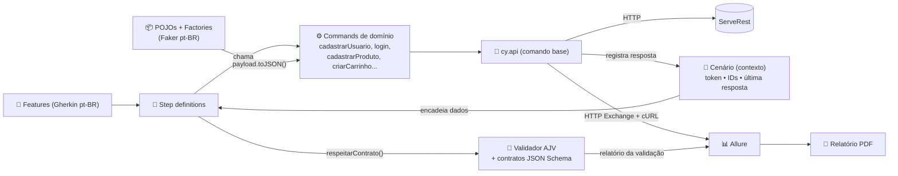
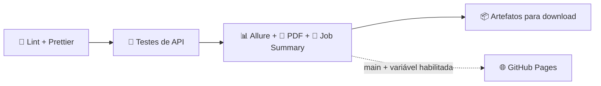

# 🧪 ServeRest • Automação de Testes de API


Automação do **fluxo principal de negócio** da [API ServeRest](https://serverest.dev): validação da integração entre **usuários → login → produtos → carrinhos**, com encadeamento de token e IDs, validação de contrato (JSON Schema), relatórios Allure e PDF, e pipeline pronto para Git Flow.

| 49 cenários | 5 funcionalidades | 14 endpoints exercitados | 14 contratos JSON Schema | ~1 min de execução |
| :---------: | :---------------: | :----------------------: | :----------------------: | :----------------: |

---

## Sumário

1. [Stack e decisões técnicas](#1-stack-e-decisões-técnicas)
2. [Arquitetura](#2-arquitetura)
3. [Estrutura do projeto](#3-estrutura-do-projeto)
4. [Padrões utilizados](#4-padrões-utilizados)
5. [Como executar](#5-como-executar)
6. [Relatórios](#6-relatórios)
7. [Pipeline CI/CD (Git Flow)](#7-pipeline-cicd-git-flow)
8. [Análise de Qualidade](#8-análise-de-qualidade)
9. [Desafio de Investigação](#9-desafio-de-investigação)
10. [Próximos passos](#10-próximos-passos)

---

## 1. Stack e decisões técnicas

| Ferramenta                                | Por que foi escolhida                                                                                                                                     |
| ----------------------------------------- | --------------------------------------------------------------------------------------------------------------------------------------------------------- |
| **Cypress 16** (`cy.request`)             | Requisições encadeadas e legíveis, Command Log para depuração e ecossistema maduro de plugins.                                                            |
| **Cucumber** (`@badeball/...`) em **pt-BR** | Cenários escritos na linguagem do negócio (`Funcionalidade`, `Regra`, `Contexto`, `Esquema do Cenário`). Servem como documentação viva.                 |
| **POJO + Custom Commands**                | Payloads modelados como classes; cada request vive em um command reutilizável. Os passos **apenas chamam** os commands, nunca `cy.request` diretamente. |
| **AJV (JSON Schema 2020-12)**             | Validação de contrato estrita, com `$ref` compartilhado, formatos (`email`), padrões (IDs, JWT) e mensagens de violação em português.                     |
| **Faker (pt-BR)**                         | Massa realista e **única por cenário**, evitando colisão no ambiente público compartilhado.                                                               |
| **Allure Report 3**                       | 100% Node.js (sem Java). Anexo nativo *HTTP Exchange*, histórico de tendências, categorias de falha e arquivo único para download.                       |
| **Puppeteer**                             | Renderiza o relatório executivo em **PDF**.                                                                                                               |
| **ESLint + Prettier**                     | Padronização e qualidade do código, verificados no pipeline.                                                                                              |

---

## 2. Arquitetura



**Camadas e responsabilidades**

- **Features**: *o quê* (regras de negócio). Nenhum detalhe técnico.
- **Steps**: traduzem o Gherkin em chamadas de commands e asserções.
- **Commands**: *como* chamar a API. Um command por operação (`POST /usuarios` → `cy.cadastrarUsuario`).
- **`cy.api`**: ponto único de saída HTTP. Desliga `failOnStatusCode`, registra a resposta no contexto, mascara o token e anexa request/response ao Allure.
- **Contexto (`Cenario`)**: o *World* do Cucumber. É por ele que token e IDs fluem entre os passos.

---

## 3. Estrutura do projeto

```text
.
├── .github/
│   ├── workflows/testes-api.yml        # Pipeline (lint → testes → relatórios → artefatos → Pages opcional)
│   └── dependabot.yml                  # Atualização semanal de dependências (target: develop)
├── cypress/
│   ├── contracts/                      # 📜 Contratos JSON Schema (draft 2020-12)
│   │   ├── definicoes.schema.json      #    componentes compartilhados via $ref (id, usuario, produto, carrinho...)
│   │   ├── comum/ usuarios/ login/ produtos/ carrinhos/
│   │   └── index.js                    #    registro central dos contratos
│   ├── e2e/features/                   # 📄 Cenários BDD em português
│   │   ├── 01-usuarios.feature
│   │   ├── 02-login.feature
│   │   ├── 03-produtos.feature
│   │   ├── 04-carrinhos.feature        #    regras de negócio do carrinho
│   │   └── 05-fluxo-de-compra.feature  #    ⭐ fluxo obrigatório ponta a ponta
│   └── support/
│       ├── pojo/                       # 📦 UsuarioPojo, LoginPojo, ProdutoPojo, CarrinhoPojo (+ PojoBase)
│       ├── factories/                  # 🏭 Geração de massa com Faker pt-BR
│       ├── commands/                   # ⚙️ Camada de requests (um arquivo por domínio) + cy.api
│       ├── step_definitions/           # 🧩 Passos (comum, usuários, login, produtos, carrinhos, hooks)
│       ├── contexto/Cenario.js         # 🧠 Encadeamento de dados entre passos
│       ├── validators/                 # 📜 Validador AJV + asserção Chai `respeitarContrato`
│       ├── allure/                     # 📊 HTTP Exchange, relatório de contrato, metadados, nomes dos passos
│       ├── hooks/ciclo-de-vida.js      # 🧹 Reinício de contexto e limpeza da massa (sempre executa)
│       ├── constants/ utils/
│       └── e2e.js
├── scripts/
│   ├── gerar-relatorio-pdf.mjs         # 📄 Relatório executivo em PDF
│   ├── resumo-execucao.mjs             # 📝 Resumo no Job Summary do GitHub Actions
│   ├── limpar-resultados.mjs
│   └── lib/                            #    leitura dos resultados Allure + template do PDF
├── allurerc.mjs                        # Configuração do Allure 3 (pt-BR, arquivo único, histórico, categorias)
├── cypress.config.js
└── .cypress-cucumber-preprocessorrc.json
```

---

## 4. Padrões utilizados

### 4.1 POJO + requests nos Commands

O payload é um **POJO** (campos privados, getters/setters e `toJSON()`):

```js
// cypress/support/pojo/UsuarioPojo.js
export default class UsuarioPojo extends PojoBase {
  #nome; #email; #password; #administrador;

  get email() { return this.#email; }
  set email(valor) { this.#email = valor; }
  // ...
  paraLogin() { return new LoginPojo({ email: this.#email, password: this.#password }); }
  toJSON() { return PojoBase.semIndefinidos({ nome: this.#nome, email: this.#email, /* ... */ }); }
}
```

A request fica **guardada no command** e é reutilizada em qualquer lugar:

```js
// cypress/support/commands/usuarios.commands.js
Cypress.Commands.add('cadastrarUsuario', (usuario) =>
  cy.api({ method: 'POST', url: ENDPOINTS.USUARIOS, body: usuario.toJSON() }),
);

// cypress/support/commands/carrinhos.commands.js
Cypress.Commands.add('criarCarrinho', (carrinho, token) =>
  cy.api({ method: 'POST', url: ENDPOINTS.CARRINHOS, body: carrinho.toJSON(), headers: comAutorizacao(token) }),
);
```

O passo só **chama**:

```js
When('eu cadastro um novo usuário {perfil}', (ehAdministrador) => {
  cy.cadastrarUsuario(UsuarioFactory.doPerfil(ehAdministrador));
});
```

### 4.2 Encadeamento de dados (token e IDs)

O token do login e os IDs gerados são publicados no **contexto do cenário** e consumidos pelos passos seguintes:

```js
When('eu realizo login com as credenciais do usuário cadastrado', () => {
  cy.login(Cenario.obter(CHAVES.USUARIO).paraLogin()).then((resposta) => {
    if (resposta.status === 200) Cenario.definir(CHAVES.TOKEN, resposta.body.authorization);
  });
});

When('eu adiciono ao carrinho os produtos:', (tabela) => {
  // apelido do Gherkin ("notebook") → _id real cadastrado no passo anterior
  criarCarrinho(carrinhoDaTabela(tabela)); // usa Cenario.tokenDaRequisicao()
});
```

> 💡 O Cypress empacota o *support file* e cada *spec* em bundles separados. Por isso o contexto vive em um singleton global (`Symbol.for`): commands e steps enxergam o **mesmo** estado.

### 4.3 Validação de contrato (JSON Schema)

- **14 contratos** em `cypress/contracts`, com definições compartilhadas reutilizadas via `$ref` (`id`, `usuario`, `produto`, `itemCarrinho`, `carrinho`).
- **Modo estrito**: `additionalProperties: false`. Um campo novo ou removido sem aviso quebra o teste, e isso é intencional: mudança de contrato precisa ser explícita.
- `allErrors` + `verbose`: todas as violações são listadas de uma vez, com caminho, regra e valor recebido, **em português**.
- Usável como passo (`E a resposta deve respeitar o contrato "carrinhos/detalhe"`), command (`cy.validarContrato(...)`) ou asserção Chai (`expect(body).to.respeitarContrato(...)`).

Exemplo real de falha (contrato errado aplicado de propósito):

```text
AssertionError: esperado que a resposta respeitasse o contrato "usuarios/detalhe", mas foram encontradas 7 violação(ões):
  1. /nome → campo obrigatório "nome" ausente
  2. /email → campo obrigatório "email" ausente
  ...
  6. /quantidade → campo "quantidade" não previsto no contrato
  7. /usuarios → campo "usuarios" não previsto no contrato
```

No Allure, cada validação ganha um card (✅/❌ com a tabela de violações) e o schema aplicado fica anexado.

### 4.4 Cenários dinâmicos

- **Esquema do Cenário** com múltiplos blocos de `Exemplos` (ex.: valores-limite, tipos, obrigatoriedade).
- **Placeholders** resolvidos em tempo de execução: `{{vazio}}`, `{{ausente}}` (remove o campo do payload), `{{usuario.email}}`, `{{usuario.password}}`, `{{email.aleatorio}}`.
- **Parameter types** do Cucumber: `{perfil}` (administrador | comum) e `{autenticacao}` (token de usuário comum | token inválido | ausência de token).
- **Tabelas de dados** com apelidos (`notebook`, `mouse`) mapeados para os IDs reais criados no cenário.

### 4.5 Isolamento e limpeza da massa

- Cada cenário cria a **própria massa** (e-mails e nomes únicos com prefixo `QA-AUTO`). Nenhum teste depende de outro.
- Listagens são sempre **filtradas pelos dados do próprio cenário**: dados de terceiros no ambiente público não interferem.
- A limpeza roda em `afterEach` (executa **mesmo quando o cenário falha**) e respeita as dependências da API: cancela carrinho (devolve estoque) → exclui produtos → exclui usuários. No Allure, aparece como *Desmontagem*.

---

## 5. Como executar

**Pré-requisitos:** Node.js 22+ (recomendado 24 LTS, ver `.nvmrc`) e npm 10+.

### Rodando no VS Code

1. Abra a pasta do projeto: *File → Open Folder...*
2. Aceite instalar as **extensões recomendadas** (Cucumber, ESLint, Prettier, EditorConfig). Com a extensão do Cucumber, `Ctrl/Cmd + clique` em um passo do `.feature` leva direto à step definition.
3. Abra o terminal integrado (*Terminal → New Terminal*) e rode os comandos abaixo.

```bash
npm ci
```

```bash
npm test
```

| Comando                  | O que faz                                                                     |
| ------------------------ | ----------------------------------------------------------------------------- |
| `npm test`               | Executa a suíte completa (headless) contra `https://serverest.dev`.            |
| `npm run test:smoke`     | Apenas `@smoke` (jornadas críticas, em poucos segundos).                      |
| `npm run test:e2e`       | Apenas o fluxo principal de compra.                                           |
| `npm run test:contrato`  | Apenas cenários com validação de contrato.                                    |
| `npm run test:negativo`  | Apenas cenários negativos.                                                    |
| `npm run test:carrinhos` | Por domínio (`test:usuarios`, `test:login`, `test:produtos`, `test:carrinhos`). |
| `npm run cy:open`        | Modo interativo do Cypress.                                                   |
| `npm run report`         | Gera Allure (`allure-report/index.html`) + PDF (`reports/pdf/`).              |
| `npm run report:open`    | Abre o Allure em um servidor local.                                           |
| `npm run lint` / `format`| ESLint / Prettier.                                                            |

**Filtrar por expressão de tags** (Cypress 16 usa `--expose`):

```bash
npx cypress run --expose tags="@carrinhos and not @negativo"
```

**Rodar contra uma ServeRest local** (isolada, sem dados de terceiros):

```bash
npm run serverest:local
```

```bash
npm run test:local
```

Variáveis de ambiente opcionais: `BASE_URL` (padrão `https://serverest.dev`) e `SLA_RESPOSTA_MS` (padrão `3000`).

---

## 6. Relatórios

| Relatório              | Onde                                     | Conteúdo                                                                                                                                       |
| ---------------------- | ---------------------------------------- | ---------------------------------------------------------------------------------------------------------------------------------------------- |
| **Allure Report 3**    | `allure-report/index.html`               | Arquivo único em pt-BR. Passos Gherkin com requests aninhadas, anexo **HTTP Exchange** (método, URL, headers, query, body, status, tempo), cURL para reproduzir, card de contrato, severidade, link para o Swagger, parâmetros dos Exemplos, categorias de falha, histórico e detecção de *flaky*. |
| **PDF executivo**      | `reports/pdf/relatorio-testes-api.pdf`   | Veredito, KPIs, rosca de status, resultado por funcionalidade, **cobertura de endpoints** (chamadas, status observados, média e p95), risco por severidade, falhas com mensagem e detalhamento de todos os cenários. |
| **Cucumber HTML/JSON** | `reports/cucumber/`                      | Relatório nativo do Cucumber + JSON/NDJSON para integrações (Xray, Jira etc.).                                                                 |
| **Job Summary**        | Página da execução no GitHub Actions     | Tabela com o resumo e a lista de falhas, sem precisar baixar nada.                                                                            |

> 🔒 O header `Authorization` e o campo `authorization` do login aparecem **mascarados** nos relatórios (`Bearer eyJhbGciOiJIUzI1…••••••[mascarado]`). O cURL usa `$TOKEN`.

**Categorias de falha no Allure:** *Contrato violado* · *Pré-condição / massa de dados* · *Status HTTP inesperado* · *Ambiente indisponível ou rede instável* · *Regra de negócio divergente* · *Erro de automação*. A triagem já começa classificada.

---

## 7. Pipeline CI/CD (Git Flow)

Arquivo: [`.github/workflows/testes-api.yml`](.github/workflows/testes-api.yml)



| Gatilho                                   | Escopo executado        | Motivo                                        |
| ----------------------------------------- | ----------------------- | --------------------------------------------- |
| `push` em `feature/**`, `bugfix/**`       | `@smoke`                | Feedback rápido durante o desenvolvimento.    |
| `push` em `develop`, `release/**`, `hotfix/**`, `main` | Regressão completa | Integração e candidata a release.       |
| `pull_request` para `develop`/`main`      | Regressão completa      | Gate de merge.                                |
| `schedule` (dias úteis, 06:00 BRT)        | Regressão completa      | Monitora a API mesmo sem commits.             |
| `workflow_dispatch`                       | Tags e ambiente à escolha | Reexecução sob demanda (`publico` ou `local-docker`). |

**Destaques:** cache do npm e dos binários (Cypress/Chrome), *health-check* da API antes dos testes (separa falha de ambiente de falha de produto), relatórios gerados **mesmo com falha**, histórico do Allure persistido entre execuções, `concurrency` para cancelar execuções obsoletas da mesma branch e entradas do usuário passadas por variável de ambiente (sem injeção de script).

**Como reexecutar:** *Actions → Testes de API • ServeRest → Run workflow* (escolha branch, tags e ambiente) ou *Re-run jobs* em qualquer execução.

**Como baixar os relatórios:** abra a execução em *Actions* e role até **Artifacts**:

- `allure-report-<n>` → descompacte e abra o `index.html` (arquivo único, abre com duplo clique, sem servidor)
- `relatorio-pdf-<n>` → PDF executivo (+ versão HTML)
- `resultados-brutos-<n>` → `allure-results` + relatórios do Cucumber

**GitHub Pages (opcional):** em *Settings → Pages*, selecione *Source: GitHub Actions* e crie a variável de repositório `PUBLICAR_RELATORIO_PAGES=true`. A cada execução da `main`, o Allure e o PDF são publicados.

**Publicando o repositório:**

```bash
git init -b main && git add . && git commit -m "feat: automação de testes de API da ServeRest"
```

```bash
git checkout -b develop
```

Depois de criar o repositório no GitHub, adicione o `remote` e faça o push de `main` e `develop`.

---

## 8. Análise de Qualidade

### 8.1 Cenários mais críticos (e por quê)

| # | Cenário                                                                 | Severidade | Por que é crítico                                                                                                         |
| - | ----------------------------------------------------------------------- | ---------- | ------------------------------------------------------------------------------------------------------------------------- |
| 1 | **Jornada completa** (usuário → login → produtos → carrinho → consulta → conclusão) | Bloqueador | É o caminho da receita. Valida a integração real e o encadeamento de token e IDs entre os 4 domínios.                    |
| 2 | **Cálculo de totais** (`precoTotal`, `quantidadeTotal`, preço unitário) | Crítico    | Erro aqui é cobrança errada: impacto financeiro e jurídico direto.                                                        |
| 3 | **Controle de estoque** (baixa na criação, devolução no cancelamento, não devolução na conclusão, limite exato, acima do estoque) | Crítico | Evita *overselling* (vender o que não existe) e estoque "fantasma" preso.                                                 |
| 4 | **Autenticação e autorização** (JWT válido, 401 sem/inválido, 403 não admin) | Bloqueador/Crítico | Porta de entrada e proteção das operações sensíveis (catálogo e carrinho).                                         |
| 5 | **Regras do carrinho** (1 por usuário, sem duplicidade, produto existente) | Crítico   | Garantem a consistência do pedido que será cobrado.                                                                       |
| 6 | **Integridade referencial** (não excluir produto/usuário vinculado a carrinho) | Crítico | Impede carrinhos órfãos e pedidos impossíveis de reconstruir.                                                             |
| 7 | **Contratos** (forma das respostas)                                     | Crítico    | O front-end depende da estrutura. Quebra silenciosa de contrato vira tela quebrada em produção.                            |
| 8 | Validações de entrada (campos obrigatórios, tipos, valores-limite)      | Normal     | Baratos de manter e protegem a qualidade dos dados, com menor impacto direto no negócio.                                  |

### 8.2 Riscos identificados durante o mapeamento

Todos observados com chamadas reais à API durante a exploração:

| Risco | Evidência | Impacto | Recomendação |
| ----- | --------- | ------- | ------------ |
| **Senha exposta** | `GET /usuarios` (público, sem token) retorna `password` em texto puro. O **payload do JWT contém a senha** em claro (base64 decodificável). | 🔴 Crítico: vazamento de credenciais / LGPD | Hash de senha, remover `password` das respostas e do token. |
| **Dados de compra públicos** | `GET /carrinhos` sem autenticação lista carrinhos de **todos** os usuários (`idUsuario`, valores). | 🔴 Crítico: privacidade | Exigir token e restringir ao dono. |
| **"Concluir compra" não gera pedido** | `DELETE /carrinhos/concluir-compra` apenas apaga o carrinho. Não existe entidade de pedido nem histórico. | 🟠 Alto: sem trilha de auditoria (ver seção 9) | Persistir pedido/pagamento com status. |
| **Semântica HTTP inconsistente** | Recurso inexistente → `400` (não `404`). Concluir/cancelar **sem carrinho** → `200` com mensagem de "não encontrado". Excluir usuário inexistente → `200`. | 🟠 Alto: o cliente da API pode tratar falha como sucesso | Usar `404`/`409` e reservar `2xx` para sucesso real. |
| **Reserva de estoque no carrinho** | O estoque baixa ao **criar** o carrinho e só volta no cancelamento. | 🟠 Alto: carrinhos abandonados prendem estoque; possível condição de corrida no limite do estoque | Reserva com expiração; teste de concorrência em ambiente isolado. |
| **E-mail case-sensitive** | Login com o mesmo e-mail em maiúsculas → `401`. | 🟡 Médio: "não consigo entrar" no suporte | Normalizar e-mail no cadastro e no login. |
| **Token curto e sem refresh** | `exp − iat = 600 s` (validado em teste). | 🟡 Médio: jornadas longas expiram no checkout | Refresh token / renovação silenciosa. |
| **Preço apenas inteiro** | `preco: 10.5` → "preco deve ser um inteiro". | 🟡 Médio: ambiguidade (reais ou centavos?) | Documentar a unidade (centavos) no contrato. |
| **Ambiente público compartilhado** | Dados de terceiros, latência variável, possíveis resets. | Risco para a **automação** (falsos negativos) | Mitigado: massa única, filtros próprios, limpeza garantida, 1 retentativa com *flaky* visível no Allure, *health-check* no CI e opção de rodar contra ServeRest em Docker. |

### 8.3 O que decidi testar

| Endpoint                           | Positivo | Negativo | Contrato | Regras de negócio validadas                                          |
| ---------------------------------- | :------: | :------: | :------: | -------------------------------------------------------------------- |
| `POST /usuarios`                   | ✅       | ✅       | ✅       | perfis admin/comum, e-mail único, obrigatoriedade e formato          |
| `GET /usuarios` · `/usuarios/{id}` | ✅       | ✅       | ✅       | persistência fiel ao enviado, filtro por e-mail, inexistente         |
| `POST /login`                      | ✅       | ✅       | ✅       | JWT Bearer, e-mail no payload, validade de 600 s, nunca retorna token em falha |
| `POST /produtos`                   | ✅       | ✅       | ✅       | nome único, valores-limite (0, negativo, decimal, tipo), 401/403     |
| `GET /produtos` · `/produtos/{id}` | ✅       | –        | ✅       | persistência, filtro por nome, estoque após cada operação            |
| `POST /carrinhos`                  | ✅       | ✅       | ✅       | 1 carrinho/usuário, duplicidade, inexistente, estoque insuficiente e exato, 401 |
| `GET /carrinhos` · `/carrinhos/{id}` | ✅     | ✅       | ✅       | dono do carrinho, itens e preço unitário, totais, filtro por usuário |
| `DELETE /carrinhos/concluir-compra` | ✅      | ✅       | ✅       | carrinho removido, estoque **não** devolvido                         |
| `DELETE /carrinhos/cancelar-compra` | ✅      | ✅       | –        | carrinho removido, estoque **devolvido**                             |
| `DELETE /produtos/{id}` · `/usuarios/{id}` | – | ✅ | ✅       | bloqueio por vínculo com carrinho (integridade)                      |

Além disso: SLA funcional de tempo de resposta (3 s, configurável) nas chamadas-chave e `Content-Type: application/json` em toda validação de contrato.

### 8.4 O que decidi **não** testar (e por quê)

| Fora do escopo | Justificativa |
| -------------- | ------------- |
| **Carga, estresse e performance** | O ambiente é público e compartilhado: gerar carga seria antiético (afeta outras pessoas) e os números não representariam produção. Mantive só um SLA funcional. Recomendo k6 contra a ServeRest em Docker. |
| **Concorrência de estoque** (dois carrinhos disputando a última unidade) | Não é determinístico em ambiente compartilhado e geraria testes instáveis. Registrado como risco, para ambiente isolado com requisições paralelas. |
| **`PUT /usuarios` e `PUT /produtos`** | Não fazem parte do fluxo de compra exigido. Com tempo limitado, priorizei profundidade nas regras de carrinho e estoque, onde está o risco financeiro. |
| **Exclusões bem-sucedidas como cenário próprio** | Já são exercitadas a cada execução na limpeza da massa (visível na *Desmontagem* do Allure). Um cenário dedicado agregaria pouco. |
| **Expiração real do token** | Exigiria esperar 10 minutos por cenário. Validei a regra pela claim `exp − iat = 600 s`, com custo próximo de zero. |
| **Segurança ofensiva** (injeção, força bruta, *fuzzing*) | Exige autorização formal e ambiente próprio. Executar contra um serviço público seria inadequado. |
| **Listagens completas sem filtro** | Dependeriam de dados de terceiros (não determinístico). Validei as listagens filtradas pelos dados do próprio cenário. |
| **Comportamentos questionáveis como requisito** (e-mail case-sensitive, `400` em vez de `404`) | Não "congelei" em teste um comportamento que provavelmente é defeito. Ficaram registrados como risco. Exceção: concluir/cancelar sem carrinho → `200`, porque está documentado no Swagger. |
| **Interface (front-end)** | O desafio é de API. |

---

## 9. Desafio de Investigação

> **Cenário:** *"Às vezes, o cliente paga, mas o pedido não aparece na tela de 'Meus Pedidos'."*
> Sem código-fonte; com acesso a produção, logs básicos e apoio de Produto e Backend.

### Primeira ação: transformar o "às vezes" em casos concretos e rastreá-los ponta a ponta

Com o Suporte e o Produto, pego **2 ou 3 ocorrências reais** (cliente, data/hora, valor, meio de pagamento e, principalmente, o **ID da transação no gateway**). Para cada uma, sigo o rastro nos logs pelo ID da transação ou *correlation id*, salto a salto:

```text
Gateway aprovou?  →  Callback/webhook chegou?  →  Pedido foi gravado?  →  Com qual status/dono?  →  A API de "Meus Pedidos" retorna?  →  A tela exibe?
```

**Por quê:** "às vezes" indica intermitência, e sem um caso real qualquer hipótese é palpite. Um único caso rastreado mostra **em qual salto o pedido some**. Cada pergunta de "sim/não" corta o espaço de busca pela metade (bisseção ao longo do fluxo), algo que nenhuma tentativa de reprodução às cegas consegue fazer tão rápido.

### Hipótese inicial

**O pagamento é confirmado de forma assíncrona e a criação ou atualização do pedido falha ou atrasa nesse caminho.** Exemplos: webhook do gateway com timeout/5xx sem retentativa, mensagem parada em fila ou DLQ, ou evento processado fora de ordem. O resultado é um pedido inexistente ou "preso" em um status que a tela filtra (ex.: `PENDENTE`).

Escolho essa hipótese primeiro porque ela explica as duas pistas do relato: **"paga"** (o gateway aprovou) e **"às vezes"** (falhas de integração assíncrona são intermitentes por natureza).

Hipóteses concorrentes que mantenho na mesa, cada uma com um teste rápido para confirmar ou descartar:

| Hipótese | Como confirmo ou descarto rapidamente |
| -------- | ------------------------------------- |
| Webhook/evento de pagamento falhou | Logs do endpoint de callback no horário (5xx, timeout); fila/DLQ; reenvios no painel do gateway. |
| Pedido criado, mas em status que a tela não exibe | Buscar o pedido pelo ID da transação via Backend e comparar o status com a regra de filtro da tela (confirmar com Produto). |
| Leitura desatualizada (cache ou réplica atrasada) | O pedido "aparece depois"? Comparar o horário de criação com o horário da consulta e o TTL do cache. |
| Pedido associado ao usuário errado (sessão, convidado, token trocado) | Verificar o `idUsuario` do pedido encontrado pela transação. |
| Duplicidade ou corrida (duplo clique, retry do app) | Dois pagamentos para um pedido? Existe chave de idempotência? |
| Defeito no front (paginação, ordenação, fuso horário) | Chamar a API de "Meus Pedidos" diretamente: se ela retorna o pedido e a tela não, o problema é do front. |

### Como reduzir a incerteza rapidamente

1. **Medir antes de opinar.** Com o Backend, rodar uma reconciliação das últimas 24–72 h: *pagamentos aprovados no gateway* × *pedidos gravados*. O "às vezes" vira número (ex.: 0,8% das transações) e uma lista de casos.
2. **Procurar padrão por segmento:** meio de pagamento (**PIX e boleto são assíncronos por natureza**, uma pista forte), plataforma (app/web), versão do app, horário de pico, valor, região. Se 100% dos casos forem de um único meio de pagamento, o problema está localizado.
3. **Montar a linha do tempo de um caso** com os logs correlacionados (*trace id*), do clique em "pagar" até a consulta da tela.
4. **Isolar camadas:** se a API retorna o pedido, o defeito é do front; se o banco tem o pedido e a API não retorna, é filtro ou cache; se nem o banco tem, é a integração com o pagamento.
5. **Reproduzir de forma controlada**, quando o padrão aparecer: uma compra real de baixo valor com conta de teste, usando o meio de pagamento suspeito, acompanhando os logs em tempo real.

**Enquanto a causa raiz não sai:** um alerta de reconciliação (pagamento aprovado sem pedido em X minutos) protege o cliente e dá ao Suporte uma lista para agir proativamente.

**Depois da correção:** testes automatizados de contrato e idempotência do webhook, um cenário de regressão "pagamento aprovado → pedido visível em Meus Pedidos" e um monitor sintético em produção.

> **Paralelo com a ServeRest:** a API concluída aqui tem exatamente essa fragilidade. `concluir-compra` **apaga o carrinho e não persiste nenhum pedido** (risco mapeado na seção 8.2). Se uma tela de "Meus Pedidos" dependesse desses dados, a compra concluída simplesmente sumiria. Sem uma entidade de pedido, não há fonte de verdade para reconciliar.

---

## 10. Próximos passos

- Testes de carga com **k6** contra a ServeRest em Docker (SLA p95 por endpoint).
- Teste de **concorrência de estoque** em ambiente isolado.
- Cobrir `PUT /usuarios` e `PUT /produtos` (atualização com conflito de e-mail/nome).
- Publicar os resultados no **Xray/Jira** a partir do JSON do Cucumber.
- *Quality gate* no Allure 3 (ex.: bloquear o merge com qualquer falha em `@severity:blocker`).
